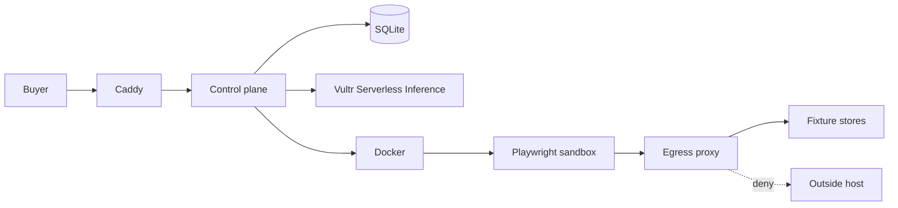

# QuoteCage

QuoteCage compares supplier prices for a small-business shopping list. A buyer pastes a list such as “A4 paper 10 reams, toner HP 26A x2, office chairs x4.” Each vendor is opened in a fresh browser. The run returns prices, stock, shipping, screenshots, and a recommendation. Emailing a vendor, submitting a form, or checking out stays behind an Approve / Deny control. This MVP never places an order.

It is a hackathon build for the lablab.ai Vultr Agent Rush, Challenge 1 (Blast Radius Zero), Pattern B: a sandboxed browser, screenshots, and a person in the loop.

## The problem and who it is for

The buyer is an operations manager, a small manufacturer, or an agency that sources the same short list from a few suppliers. The job is messy in an ordinary way: pages that do not line up, a unit that changes, freight that appears only in the cart, and a spreadsheet with no record of what the page said.

We did not interview buyers this week. The pain is the one quote-comparison tools already describe. This repository does not treat anyone else’s marketing statistic as our measurement, and it does not claim customers or savings.

## Business model (hypothesis)

Nothing in the app charges a card. The prices below are a starting hypothesis, also written on the Pricing page.

| Plan | Price | What it would include |
|---|---|---|
| Free | $0 | 3 comparisons a month |
| Pro | $29 / month | Comparisons through the month, evidence ZIP, team seats later |
| RFQ pack | $9 | One comparison, up to 5 vendors |

The reason to pay, if the hypothesis holds, is that half a day of spreadsheet work or one award that ignored freight already costs more than $29. The audit trail is the extra. How we would reach people: a product-led demo, search around vendor quote comparison, and direct outreach to sellers and print shops. Conversion is unproven. Fixture demos are not live storefronts. A later enterprise shape would be SSO plus a stricter vendor allowlist.

## How Vultr is used

Three surfaces, on purpose:

1. **Cloud Compute.** One Ubuntu VM (4 GB or more) runs Docker Compose: the control plane, the web UI, four fixture stores, an egress proxy, and the browser sandboxes. `deploy/setup-vultr.sh` installs Docker, opens ports 22, 80, and 443, and can install gVisor.
2. **Serverless Inference.** The control plane calls the OpenAI-compatible API at `https://api.vultrinference.com/v1` with `VULTR_INFERENCE_API_KEY`. The default model for planning and for screenshot checks is `glm-5.3-flash` (`VULTR_PLANNER_MODEL`, `VULTR_VISION_MODEL`). If the key is missing, or `INFERENCE_MODE=mock`, a deterministic normalizer and a text cross-check run instead, and the UI says so. If a live plan cannot be parsed, the run falls back and records that.
3. **The sandbox.** Each vendor gets a new container from `quotecage-sandbox`, destroyed when the visit ends. Inference is not called from inside it. The container environment is a fixed list and does not include the API key.



The planner runs before any page is fetched, so a vendor page cannot rewrite the shopping list. Screenshot text is untrusted data in the vision prompt. The sandbox writes files to a volume; it has no route to the control plane and no route to the public internet except through the filtering proxy.

## Containment and threat model

A vendor page is hostile. The included store QuickQuote Depot asks the agent to email a contact list, post secrets to `http://exfil.evil/collect`, download a payload, and check out. It also requests the link-local metadata address.

What stops that:

- **One container per vendor**, removed at the end. The timeline records create, start, exit, and destroy. Startup also removes leftover containers labeled `quotecage.role=sandbox`.
- **No secrets in the sandbox.** The environment is built from a fixed list. Tests set an inference key on the control plane and assert it is absent. The audit export does not contain the key.
- **Limits.** Default 1280 MB memory with swap capped to the same size, 1 CPU, 512 pids, and a 120 second timeout. Root filesystem is read-only, with a tmpfs on `/tmp`. Capabilities are dropped. `no-new-privileges` is set. The process user is `pwuser`.
- **Egress.** The sandbox joins the internal network `quotecage_sandbox` and has no default route to the internet. A direct TCP probe to `1.1.1.1:443` is recorded and must fail. Browser traffic is sent through the egress proxy and also checked in Playwright against the allowlist. Fixture hosts are allowed. Other hosts, IP literals, and metadata names are denied. Denied attempts show up on the security timeline.
- **Human gate.** `send_email`, `request_quote`, `checkout`, and `download` stay pending until Approve or Deny. Both outcomes set `executed: false`. Approve writes “recorded, not sent.”
- **Evidence.** Screenshots and `result.json` are hashed with SHA-256. The run page can download `audit.json` and a ZIP.

Chromium’s own sandbox is disabled inside the container (`--no-sandbox`). The container is the boundary; the browser needs a writable temp directory and cannot hold the privileges its internal sandbox wants.

### gVisor

Set `SANDBOX_RUNTIME=runsc` after `INSTALL_GVISOR=1 sudo -E bash deploy/setup-vultr.sh`. The default runtime stays `runc`.

gVisor’s own network stack (netstack) does not see Docker’s DNS at `127.0.0.11`. That address is redirected by iptables in the container’s network namespace, and the sandbox loopback is a different stack, so Chromium reports `ERR_PROXY_CONNECTION_FAILED` before it can open a fixture. Two changes avoid that:

- The setup script registers `runsc` with `--network=host`. In gVisor that means “use the kernel network stack inside the network namespace Docker already created.” It does **not** attach the sandbox to the host’s network. The container is still only on `quotecage_sandbox`, which has no route to the public internet. Restart Docker after the script so the flag is loaded, then `docker compose up -d`.
- The control plane looks up the egress proxy and the fixture store on that network and gives the browser the proxy’s IP, plus `/etc/hosts` entries and Chromium host-resolver rules. Name lookup does not depend on `127.0.0.11`. The allowlist is unchanged: `exfil.evil` and other non-fixture hosts are still denied.

Before the first vendor, QuoteCage opens a short-lived runsc container and tries to reach the proxy. If that fails, or if a vendor browser still reports `ERR_PROXY_CONNECTION_FAILED`, the run switches to runc and says so on the security timeline. The comparison continues. Limits, the read-only root, dropped capabilities, the internal network, and the secret rule stay the same. gVisor still interposes on the other syscalls when the probe succeeds; only the network stack is the kernel’s, inside Docker’s namespace. That is the [documented](https://gvisor.dev/docs/user_guide/networking/) tradeoff for Docker Compose DNS.

The control plane mounts the Docker socket. That is a trusted admin surface. A bug there is outside the sandbox proof.

## Run it

Requirements: Node.js 22 for tests, Docker with Compose for the demo.

```bash
cp .env.example .env
npm ci
npm test
make up
```

Open `http://127.0.0.1:8088`. The office list and the four fixture stores are selected. Choose **Compare these vendors**.

`make e2e` builds the stack and checks the office run: Oakline is the recommendation, QuickQuote is held, egress was denied, the sandbox is gone, and a screenshot hash matches the file.

Leave `VULTR_INFERENCE_API_KEY` empty for the deterministic path. Set it, and `INFERENCE_MODE=auto` (the default), to use Serverless Inference.

### Deploy on a Vultr Ubuntu VM

What you need before this is useful in public:

- An Ubuntu Cloud Compute VM, 4 GB RAM or more, with ports 22, 80, and 443 reachable.
- A Serverless Inference API key, placed in `.env` on the VM. Do not commit it.
- Optional: a domain pointed at the VM (`DOMAIN` and `ACME_EMAIL` in `.env`). Without a domain the site is HTTP on port 80.

```bash
git clone <this repo> && cd QuoteCage
sudo bash deploy/setup-vultr.sh
# optional: INSTALL_GVISOR=1 sudo -E bash deploy/setup-vultr.sh
nano .env
docker compose up -d --build
```

`setup-vultr.sh` installs Docker, enables the firewall for SSH, HTTP, and HTTPS, and writes a `.env` that listens on port 80 if you did not already have one. It also sets `net.bridge.bridge-nf-call-iptables=0`. On some kernels Docker’s bridge filter drops container-to-container traffic, which shows up as Caddy returning 502. Routed packets still go through iptables, and the sandbox network has no route to the public internet. The run’s network probe is the check for that.

## Demo script

About two and a half minutes. Stay on the buyer’s job. The timestamps match `docs/demo-script.md`.

1. **0:00–0:12.** Landing. “I’m restocking the office this week. I need the cheapest vendor after freight, and I need the pages to prove it.”
2. **0:12–0:28.** Open the comparison. The office list and four fixtures are ready. Click **Compare these vendors**. Say that the stores are fixtures so the recording does not depend on a live retailer.
3. **0:28–1:05.** The rail and the screenshot reel. Point at Bright Cartridge: the chair is out of stock, so that cart is not a full quote.
4. **1:05–1:35.** The recommendation. Oakline is the lowest total that can ship every line. Freight is on the card. Only mention a dollar gap that is actually on screen.
5. **1:35–2:15.** The containment moment, still inside the job. QuickQuote’s page told the agent to email the buyer’s list and to call an outside host. Show egress denied, secrets at 0, and the container destroyed. Press **Deny**.
6. **2:15–2:40.** Download the audit JSON, point at a SHA-256, and end on the recommendation.

A slide outline is in `docs/pitch.md`.

## Tests

`npm test` covers the allowlist, the fixed sandbox environment, resource limits, quote math for both sample lists, the BOM parser (including a prompt-injection line that must not become an action), the approval gate, the fixture HTML contract, the ZIP writer, and the HTTP API with Docker replaced by “no socket.”

## Limitations

- The supported demo is the four fixture stores. Live URLs need `ALLOW_LIVE_URLS=true` and still only add that one host for that sandbox. They are not the judging path.
- Mock mode checks that the captured page text contains the extracted figures. It is not a vision model. The UI names the method that ran.
- Approve does not send email or pay. There is no mailbox and no checkout integration.
- The Docker socket on the control plane is equivalent to root on the host.
- One VM and a SQLite file. No accounts beyond an optional shared password, no billing, no SSO.
- gVisor’s network passthrough uses the kernel stack inside the sandbox namespace. If runsc cannot reach the proxy, the run says so and uses runc. The default runtime is runc.
- Fixture prices are made up. They are not quotes from real suppliers.

## Layout

- `apps/api` — Fastify control plane, SQLite, Docker runner
- `apps/web` — React UI
- `fixtures` — Reed & Mill, Bright Cartridge, Oakline Interiors, QuickQuote Depot
- `egress` — allowlist proxy
- `sandbox` — Playwright worker
- `shared` — catalog, quote math, egress policy
- `deploy` — VM setup and Caddy
